# Показ эксперту на 30 минут

Полный сценарий с текстом для проговаривания и вопросами-ответами к каждому блоку. Текст в блоках «Что говорить» можно читать почти дословно. Цифры в примерах взяты с демо-стенда и со временем меняются (сроки идут от сегодняшней даты), поэтому называйте то, что видите на экране.

## 0. Подготовка (за 15 минут до показа)

**Вкладки браузера, по порядку:**
1. https://litvinskiy-dev.ru под менеджером (`manager@zapas.local`). Пароль в README, раздел «Демо-данные и учётные записи». После входа выбрать заведение «Кухня «Набережная»».
2. Вторая вкладка с тем же адресом под кладовщиком (`keeper@zapas.local`) в окне инкогнито: понадобится для показа прав.
3. Третья вкладка в другом окне: официант (`waiter@zapas.local`), заведение «Кухня «Набережная»», вкладка «Заказ». Можно открыть на телефоне.
4. Четвёртая вкладка: кабинет поставщика https://litvinskiy-dev.ru/supplier/ под `zakaz@donskoy-moloko.example` (пароль в README).
5. Презентация (запасной вариант, если что-то отвалится).
6. Telegram на телефоне или в десктопе, бот @zapashack_bot, аккаунт заранее привязан к менеджеру.

**Терминал.** В репозитории, `npm ci` выполнен:

```bash
npm run emulate -- --url https://litvinskiy-dev.ru --email manager@zapas.local --password '<пароль менеджера>' --speed 3
```

Не запускайте до блока 9.

**Касса и 1С (блок 12) показывайте на локальном стенде**, а не на сервере: имитация 1С живёт на ноутбуке, и серверу до неё не достучаться. Заранее на ноутбуке: поднять локальный стенд, `npm run emulate:onec`, затем `npm run emulate:setup`, в `apps/server/.env` должно быть `EXCHANGE_ALLOW_HOSTS=127.0.0.1`. Отправка чеков кассой на серверный адрес работает и из дома (`npm run emulate:pos -- --url https://litvinskiy-dev.ru --key zk_... --vendor evotor`), но выгрузка в 1С только локально.

**Запасной план.** Если стенд не открылся: презентация и раздел «Руководство» со скриншотами, затем локальный стенд. Если не отвечает бот: показать диалог на слайде 10. Если нет интернета: всё локально (`npm run dev`).

**Не показывать:** пароль администратора, токен бота, прокси и содержимое `.env`.

## Тайминг

| № | Блок | Минут |
|---|---|---|
| 1 | Вступление, вход и выбор заведения | 2 |
| 2 | Обзор | 2 |
| 3 | Остатки и партии | 2 |
| 4 | Приход поставки | 1 |
| 5 | Заказ гостя и отказ | 1 |
| 5а | Официант и заявки гостей | 3 |
| 6 | Стоп-лист и его прогноз | 2 |
| 7 | Горячие предложения | 2 |
| 8 | Рекомендации и прогноз спроса | 1 |
| 9 | Живое обновление | 1 |
| 10 | Поставщики, потери, уценка | 1 |
| 10а | Кабинет поставщика | 3 |
| 11 | НАССП и прослеживаемость | 1 |
| 12 | Кассы и 1С | 3 |
| 13 | Telegram-бот | 1 |
| 14 | Интерфейс, сканер, руководство | 1 |
| 15 | Безопасность, надёжность, стек | 1 |
| 16 | Итоги | 1 |
|   | Запас времени | 1 |

---

## Карта экранов

Быстрая ориентация: куда нажать и какой снимок смотреть.

| № | Блок | Путь в меню | Снимок |
|---|---|---|---|
| 1 | Выбор заведения | после входа, экран «Выберите заведение» | [select-location](../apps/web/public/help-img/select-location.jpg) |
| 2 | Обзор | Учёт → Обзор | [dashboard](../apps/web/public/help-img/dashboard.jpg) |
| 3 | Остатки | Учёт → Остатки, строка → карточка | [stock](../apps/web/public/help-img/stock.jpg), [карточка](../apps/web/public/help-img/stock-drawer.jpg) |
| 4 | Приход | Учёт → Операции → Приход | [operations](../apps/web/public/help-img/operations.jpg) |
| 5 | Заказ гостя | Учёт → Операции → Заказ гостя | [op-guest](../apps/web/public/help-img/op-guest.jpg) |
| 5а | Официант | вход `waiter@zapas.local`, экран «Заказ» | [waiter-order](../apps/web/public/help-img/waiter-order.jpg) |
| 5а | Заявки гостей | Учёт → Заявки гостей (Операции → Заявки гостей) | [guest-orders](../apps/web/public/help-img/guest-orders.jpg) |
| 6 | Стоп-лист | Решения → Стоп-лист | [stoplist](../apps/web/public/help-img/stoplist.jpg) |
| 7 | Горячие предложения | Решения → Горячие предложения | [hot](../apps/web/public/help-img/hot.jpg) |
| 8 | Рекомендации | Решения → Рекомендации | [recommendations](../apps/web/public/help-img/recommendations.jpg) |
| 10а | Кабинет поставщика | https://litvinskiy-dev.ru/supplier/ | [supplier-order](../apps/web/public/help-img/supplier-order.jpg) |
| 10 | Поставщики | Решения → Поставщики | [suppliers](../apps/web/public/help-img/suppliers.jpg) |
| 11 | НАССП, ВСД | Учёт → Журнал НАССП, Прослеживаемость | [haccp](../apps/web/public/help-img/haccp.jpg), [traceability](../apps/web/public/help-img/traceability.jpg) |
| 12 | Кассы и 1С | Система → Администрирование → Кассы, Учётные системы | [кассы](../apps/web/public/help-img/adm-keys.jpg), [1С](../apps/web/public/help-img/ex-systems.jpg) |
| 13 | Telegram | меню пользователя → Telegram | [user-menu](../apps/web/public/help-img/user-menu.jpg) |
| 14 | Интерфейс | меню пользователя, Ctrl+K, Руководство, Тестирование | [test-checks](../apps/web/public/help-img/test-checks.jpg) |
| 15 | Безопасность | Администрирование → Журнал аудита | [adm-audit](../apps/web/public/help-img/adm-audit.jpg) |

---

## 1. Вступление, вход и выбор заведения (2 мин)

**Открыто:** обложка презентации или страница входа. Войти менеджером: после входа открывается экран «Выберите заведение», выбрать «Кухня «Набережная»». Сказать: платформа многопользовательская, у каждой организации свои заведения и сотрудники, администратор может добавить заведение и завести сотрудников со временным паролем, а регистрация организации с нуля есть на странице входа.

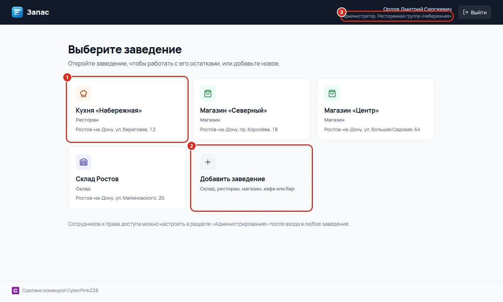

*Экран выбора заведения.* Красные кружки на картинке:

1. Карточка заведения: нажмите, чтобы открыть его
2. Добавить новое заведение (только администратор)
3. Кто вошёл и в какой организации

**Экран с подсказками**

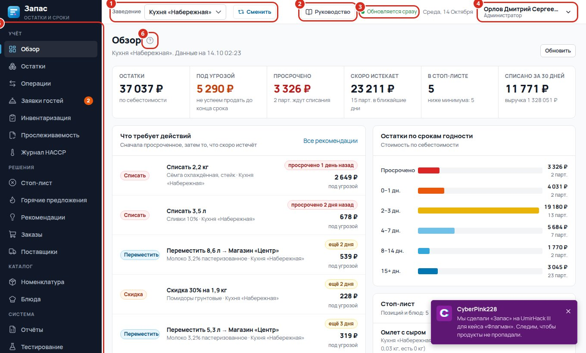

*Шапка и боковое меню системы.* Красные кружки на картинке:

1. Заведение, с которым вы работаете, и кнопка «Сменить» для возврата к выбору
2. Кнопка с полным руководством пользователя
3. Индикатор живого обновления данных
4. Меню пользователя: смена пароля и привязка Telegram
5. Разделы системы, сгруппированные по задачам
6. Кнопка «?» с кратким пояснением раздела

**Что говорить.** Здравствуйте. Мы команда CyberPink228: Никита Литвинский, fullstack-разработчик, и Юлия Борисенко, UI/UX-дизайнер. Наше решение называется «Запас». Идея одной фразой: продукты не пропадают. Система следит за остатками и сроками годности, ведёт стоп-лист и, главное, сама подсказывает, что делать: списать, уценить, переместить или заказать, сразу с суммой. Все 17 условий кейса выполнены, а сверх кейса мы подключили кассы, 1С и Telegram. Система уже работает на сервере, поэтому всё, что вы увидите, живое, не макет.

**Вопросы и ответы**

**Чем «Запас» отличается от iiko и 1С?**
Мы не заменяем учётную систему, а добираем то, чего ей обычно не хватает: партии и сроки по каждой поставке, стоп-лист по ингредиентам, горячие предложения. Данные идут туда, где они уже живут: чеки приходят из касс, документы уходят в 1С, приход можно отдать в iiko.

**Это готовый продукт или прототип?**
Рабочий прототип с боевой архитектурой: развёрнут по HTTPS, есть роли, журнал аудита, тесты на реальной базе. Что не доведено до продукта, мы называем сами (в конце блока 15).

**Кто что делал?**
Никита: серверная часть, база, интеграции, деплой. Юлия: интерфейс и дизайн, бренд, справка и скриншоты.

---

## 2. Обзор (2 мин)

**Открыто:** «Обзор», заведение «Кухня «Набережная»».

**Что показать:** карточки сверху (остатки, под угрозой, просрочено, скоро истекает, в стоп-листе, списано за 30 дней), блок «Что требует действий», график «Остатки по срокам годности», блок стоп-листа.

**Экран с подсказками**

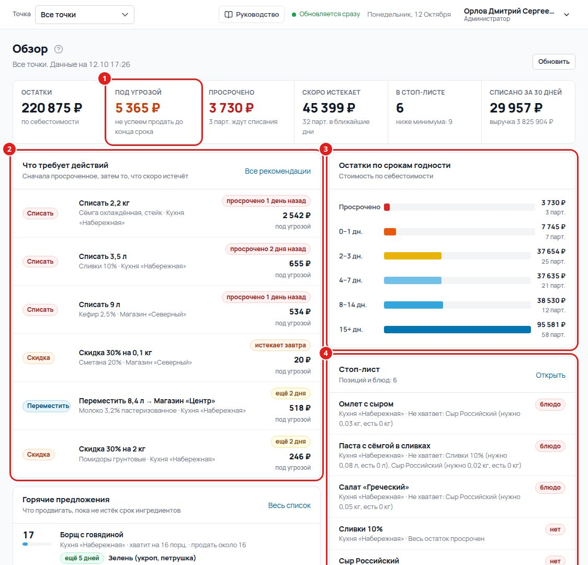

*Раздел «Обзор».* Красные кружки на картинке:

1. Сводка: стоимость остатков, что под угрозой, просрочено, скоро истекает, стоп-лист, списания
2. Очередь действий: сначала просроченное, затем то, что скоро истечёт
3. Сколько денег лежит в партиях с разным запасом по сроку
4. Короткая сводка стоп-листа со ссылкой на раздел

**Что говорить.** Это обзор руководителя. Первая карточка: сколько денег лежит на складе по себестоимости. Вторая, самая важная: деньги под угрозой, то есть сколько мы не успеем продать до конца срока при текущей скорости продаж. Посмотрите, это не просто «скоро истекает», а расчёт по партиям: для каждой партии система считает, сколько успеют продать, а остальное и есть риск. Ниже список действий: сначала просроченное, потом срочность, потом сумма. У каждой строки действие и сумма: списать, скидка, переместить. Справа остатки по срокам: просрочено, сегодня, три дня, неделя и дальше. Всё обновляется само, без перезагрузки: видите индикатор «Обновляется сразу».

**Вопросы и ответы**

**Как считается «под угрозой»?**
Партии берутся по порядку FEFO. Для партии: горизонт равен дням до срока плюс один, успеют продать скорость продаж умножить на горизонт минус то, что нужно продать из предыдущих партий, ограничено остатком партии. Остальное под угрозой, в деньгах по себестоимости. Просроченная партия целиком считается потерей. Партии со сроком дальше 14 суток риском не считаются: прогноз на месяцы вперёд даёт ложные тревоги.

**Откуда скорость продаж?**
Из движений продаж и отгрузок за 28 суток. Последняя неделя весит вдвое больше остальных, сегодняшний день не берём, он не закончился. Если истории меньше недели, прогнозу не верим: риск считается только по сроку, под угрозой всё, что истекает в ближайшие три суток.

**А если данные неверные?**
Журнал движений неизменяем (триггеры и права базы), ошибочную операцию не удаляют, а исправляют новой. Есть инвентаризация: недостача списывается по FEFO, излишек оформляется новой партией.

**Почему «себестоимость», а не цена продажи?**
Потеря компании это то, что она заплатила за товар. Выручка от продаж считается отдельно в отчётах.

---

## 3. Остатки и партии (2 мин)

**Открыто:** «Остатки», вкладки «Позиции» и «Партии», затем любая строка, например «Сливки 10%» или молоко.

**Что показать:** статусы и полоса срока, фильтры «Ниже минимума», «Истекают», «Просрочены», карточка позиции: партии с остатком, расход за 28 дней, прогноз спроса на 14 дней.

**Экран с подсказками**

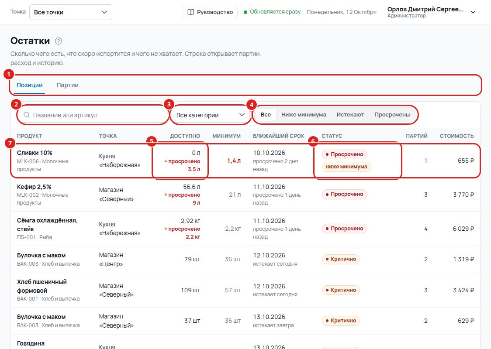

*Раздел «Остатки».* Красные кружки на картинке:

1. Переключатель «Позиции» и «Партии»
2. Поиск по названию или артикулу
3. Фильтр по категории
4. Быстрые фильтры: ниже минимума, истекают, просрочены
5. Годный остаток и просроченный отдельно
6. Статус по ближайшему сроку
7. Щелчок по строке открывает партии, расход и историю

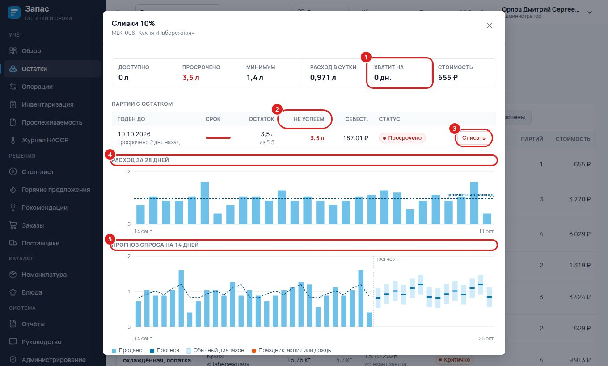

*Карточка позиции.* Красные кружки на картинке:

1. Хватит на: на сколько дней достаточно остатка при текущем расходе
2. Часть партии, которую не получится продать до конца срока
3. Списание партии прямо из карточки
4. Расход по дням и расчётная скорость продаж
5. Прогноз спроса на две недели вперёд с коридором неопределённости

**Что говорить.** «Остатки» показывают продукты, а за строкой скрываются партии. Каждая поставка это отдельная партия со своим сроком и своей себестоимостью. Статусы четыре: в норме, скоро истекает, критично, просрочено. Пороги настраиваются: по умолчанию критично за сутки, скоро за трое. Откроем позицию. Сверху доступно, просрочено, минимум, расход в сутки и на сколько дней хватит. Ниже партии с оставшимся временем. Ниже график фактического расхода за 28 дней и прогноз спроса на 14 дней: учитывается день недели, праздники и погода. Серая полоса это обычный диапазон. Расход идёт по принципу FEFO: первой уходит партия с ближайшим сроком.

**Вопросы и ответы**

**Как работает FEFO при конкурентных продажах?**
Одна транзакция на документ. Кандидаты выбираются `SELECT ... FOR UPDATE` в детерминированном порядке (строки сортируются по идентификатору продукта до блокировки), поэтому два параллельных документа не уйдут во взаимную блокировку. Есть тест: двадцать параллельных продаж на остаток в десять единиц продают ровно десять.

**Что, если на партии срок не указан?**
При приходе срок задаётся датой или сроком хранения в днях (берётся из карточки продукта). Дата в прошлом отклоняется, если не включён флаг приёмки уже просроченного товара, он нужен для учёта брака.

**Что такое «доступно» и «на руках»?**
Доступно это остаток непросроченных партий, то, что можно продать. «На руках» включает просроченное, пока его не списали.

**Как прогноз учитывает погоду и праздники?**
Погода берётся из открытого сервиса Open-Meteo по координатам точки, праздники из календаря в настройках. Это поправки к базовой скорости, а не отдельная модель машинного обучения. Мы показываем, насколько они помогают (блок 8).

---

## 4. Приход поставки (1 мин)

**Открыто:** «Операции → Приход».

**Что показать:** выбрать поставщика и точку, добавить строку с молоком, срок хранения подставляется из карточки. Можно указать готовую дату срока. Упомянуть приход по накладной (загрузка УПД) и сканер.

**Экран с подсказками**

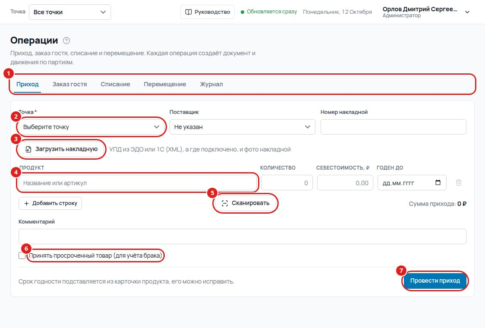

*Раздел «Операции», вкладка «Приход».* Красные кружки на картинке:

1. Виды операций: приход, заказ гостя, списание, перемещение, журнал
2. Точка, на которую приходит товар
3. Загрузка накладной: УПД или фото
4. Выбор продукта по названию, артикулу или штрихкоду
5. Ввод по штрихкоду камерой или сканером
6. Приёмка брака: партия сразу уйдёт в списание
7. Проведение документа: создаются партии

**Что говорить.** Приход это документ: поставщик, номер, дата и строки. У каждой строки продукт, количество, срок хранения в днях или готовая дата, цена закупки. Срок подставляется из карточки продукта, но его можно поменять для конкретной партии. Для магазинов есть сканер штрихкодов камерой или USB-сканером, и загрузка УПД файлом: система сама сопоставляет позиции с номенклатурой. То же самое делает API: `POST /documents/receipts`.

**Показать накладные.** «Тестирование → Накладные»: открыть «Чистый скан ТОРГ-12», нажать «Разобрать здесь». Через 10-15 секунд видно поставщика (найден по ИНН), пять строк и продукт напротив каждой. Затем «Печать и товар, которого у нас нет»: кетчуп остаётся без пары, это нормально и показывает, как система ведёт себя с неизвестным. Образец с XML разбирается мгновенно и без распознавания.

**Вопросы и ответы**

**Чем читаются фото накладных?**
Через GigaChat (API Сбера): картинка уходит в сервис, сразу там удаляется, у нас не хранится. Ответ проверяется строгой схемой, а на экране остаётся предупреждение «сверьте с бумагой». Это единственное место, где мы используем модель; прогнозы, стоп-лист и рекомендации считаются обычными алгоритмами.

**Что, если связь пропала?**
Операции кладутся в очередь на устройстве (IndexedDB) с ключами идемпотентности и отправляются после восстановления связи, повтор не создаёт второй документ.

**Как защититься от двойного ввода?**
Заголовок `Idempotency-Key`: повтор с тем же ключом возвращает уже созданный документ, повтор с другим телом это конфликт.

**Поддерживается маркировка и ВСД?**
Да, номер ВСД и коды марок записываются при приходе. Подробнее в блоке 11.

---

## 5. Заказ гостя и отказ (1 мин)

**Открыто:** «Операции → Заказ гостя», точка кухня «Набережная».

**Что показать:** выбрать «Борщ с говядиной», количество 200: система отклоняет заказ целиком и называет, какого ингредиента и сколько не хватает. Затем количество 2: заказ проходит, ингредиенты списываются по рецептуре.

**Экран с подсказками**

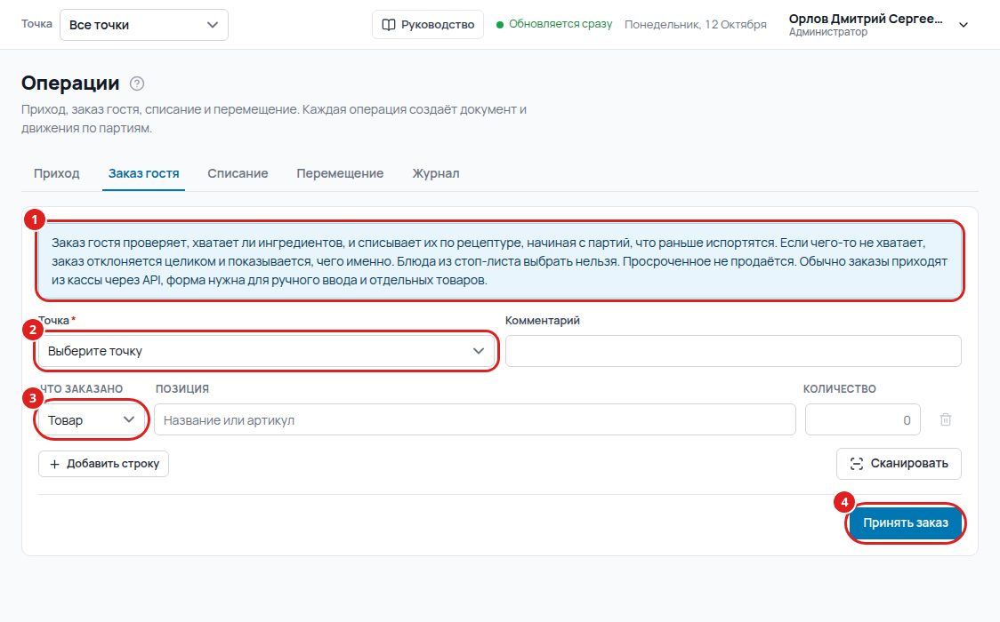

*Операции, вкладка «Заказ гостя».* Красные кружки на картинке:

1. Правила: заказ принимается целиком или отклоняется с причиной
2. Точка, где оформляется заказ
3. Что заказано: товар или блюдо
4. Принять заказ: ингредиенты спишутся по рецептуре

**Что говорить.** Заказ блюда проверяется целиком. Берём борщ в количестве двухсот порций. Система не продаёт «сколько есть», а отклоняет заказ и говорит, чего и сколько не хватает. Теперь две порции: заказ прошёл, ингредиенты списаны по рецептуре и по FEFO. Частичной продажи нет, это условие кейса и наш принцип.

**Вопросы и ответы**

**Почему отказ целиком, а не частичная продажа?**
Так требует кейс, и так честнее для гостя. Мы пишем отказ в `sale_refusals` вместе с недостающими продуктами и суммой заказа: из них потом считается рейтинг дефицитных ингредиентов и упущенная выручка.

**Как списываются ингредиенты?**
Блюдо раскладывается по рецептуре на продукты, каждый продукт расходуется по FEFO. Цена движения фиксируется отдельно.

**Где рецептуры?**
«Блюда»: ингредиенты и расход на порцию. Там же видно, сколько порций можно приготовить сейчас.

---

## 5а. Официант и заявки гостей (3 мин)

**Открыто:** окно официанта (`waiter@zapas.local`, «Кухня «Набережная»») рядом с окном менеджера, «Операции → Заявки гостей».

**Что показать:**
1. У официанта на экране «Заказ»: горячие блюда помечены, блюдо из стоп-листа серое и подписано причиной, выбрать его нельзя. Добавить борщ два раза, стол 7, «Отправить на кухню».
2. У менеджера заявка появилась сама, счётчик у «Заявки гостей» вырос. «Взять в работу»: продукты списались по рецептуре. У официанта в «Мои заказы» статус стал «В работе».
3. «Что-то пошло не так» у официанта: «Разбили или уронили по пути», вина официанта, комментарий. У менеджера «Решить» → «Переделать бесплатно»: в заказ добавилось блюдо без оплаты, потеря посчитана по себестоимости.
4. Вкладки «Горячее» и «Стоп-лист» у официанта: коротко, без расчётов.

**Экраны с подсказками**

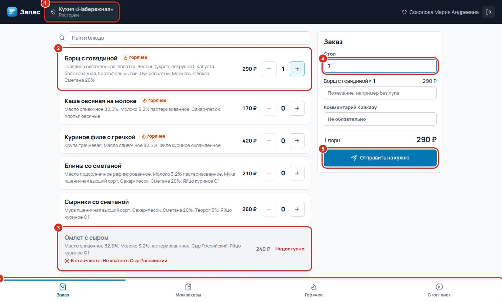

*Экран официанта.* Красные кружки на картинке:

1. Заведение, в котором работает официант, нажатие возвращает к выбору
2. Горячее блюдо: его стоит предложить гостям первым
3. Блюдо из стоп-листа: выбрать нельзя, причина подписана
4. Стол или номер заказа
5. Отправить заказ на кухню
6. Вкладки: заказ, мои заказы, горячее, стоп-лист

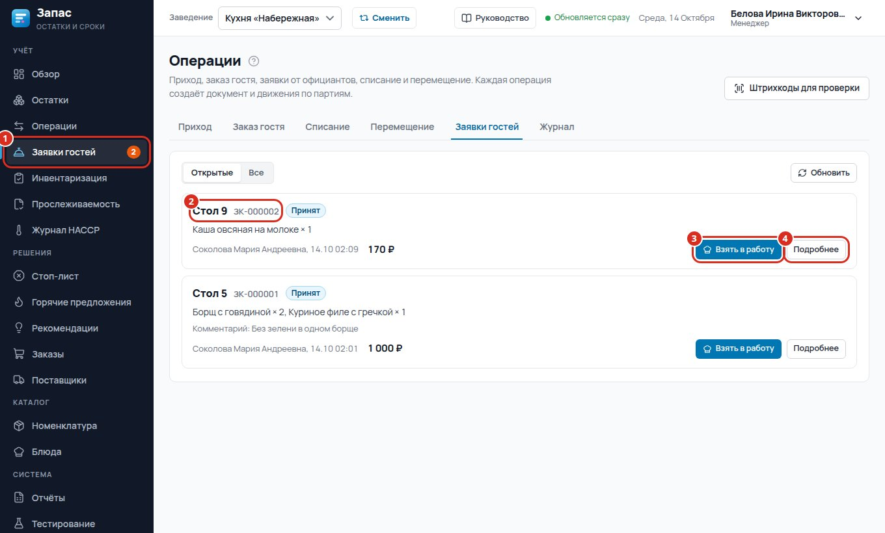

*Заявки у менеджера.* Красные кружки на картинке:

1. Пункт меню со счётчиком открытых заявок
2. Заявка: стол, номер и статус
3. Взять в работу: продукты спишутся по рецептуре
4. Подробности, история и обращения по заказу

**Что говорить.** Здесь мы закрываем ещё один кейс: заказ принимает не человек за кассой, а официант в зале, и ему нельзя продать то, чего нет. Видите, омлет серый, и причина подписана одной строкой: не хватает сыра. Выбрать его нельзя, а если экран устарел, сервер всё равно откажет. Официант отправил заказ, менеджер видит его сразу. Продукты списываются, когда заказ берут в работу, а не в момент оформления: так отмена до готовки ничего не ломает. А теперь жизненная ситуация: тарелка разбилась по дороге. Официант сообщает, чья вина и что произошло, менеджер решает. «Переделать бесплатно» добавляет блюдо без оплаты и списывает продукты как потерю с пометкой виновного, потеря считается по себестоимости партий. Всё остаётся в истории заказа и в журнале. Экран официанта намеренно урезан: нет остатков, отчётов и справочников, а горячие предложения без расчётов.

**Вопросы и ответы**

**Почему продукты списываются не при оформлении?**
Заказ может быть отменён, пока его не начали готовить. Списание в момент «Взять в работу» совпадает с реальным расходом продуктов. Если к этому моменту чего-то не хватает, заказ остаётся принятым, а менеджер видит, чего именно.

**Что если официант ошибся и блюдо уже готовят?**
Отменить свой заказ он может только до взятия в работу. Дальше решает менеджер: отмена с причиной (продукты уже списаны и назад не вернутся) или обращение с переделкой.

**Кто видит заказы?**
Официант только свои, менеджер и администратор все заказы своего заведения. Чужая организация не видит ничего.

**Можно ли сделать несколько официантов и несколько заведений?**
Да. Администратор заводит сотрудников и назначает им заведения, а официант выбирает своё заведение после входа.

---

## 6. Стоп-лист и его прогноз (2 мин)

**Открыто:** «Стоп-лист».

**Что показать:** блок «Прогноз стоп-листа» (через сколько часов блюдо остановится и какой ингредиент ограничивает), таблица: причина, время входа, источник «Автоматически», кнопка «Добавить вручную».

**Экран с подсказками**

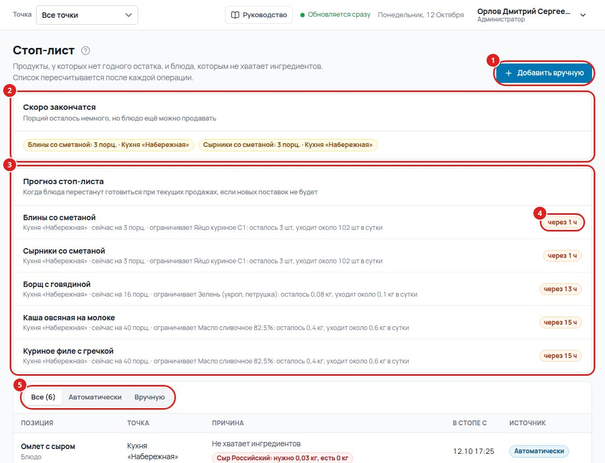

*Раздел «Стоп-лист».* Красные кружки на картинке:

1. Ручное добавление позиции или блюда в стоп-лист
2. Блюда, которых осталось на несколько порций
3. Когда блюда уйдут в стоп при текущих продажах
4. Время до стопа
5. Фильтр по источнику: автоматически или вручную

**Что говорить.** Стоп-лист строится сам и пересчитывается после каждой операции, плюс раз в минуту планировщиком. Позиция попадает в стоп, когда нет годного остатка или блюду не хватает ингредиента на порцию. Вверху прогноз: через сколько часов блюдо перестанет готовиться при текущих продажах и какой ингредиент его ограничивает. Здесь, например, борщ остановится через несколько часов из-за зелени. Это позволяет заказать заранее, а не узнать от гостя. Есть и ручной стоп с причиной и сроком.

**Вопросы и ответы**

**Как считается прогноз остановки?**
Для каждого ингредиента строится часовая кривая годного остатка на неделю: партии расходуются по FEFO равномерно со скоростью продаж, остаток партии пропадает в конце суток её срока. Остановкой считается первый час, когда ингредиента не хватает на порцию.

**Что прогноз не учитывает?**
Новые поставки и открытые заказы поставщикам, расход считается равномерным в течение суток. Если по ингредиенту мало истории, учитывается только срок годности.

**Не будет ли стоп-лист «мигать»?**
Пересчёт после операций склеивается: десяток продаж подряд даёт один проход (задержка 1,5 секунды). Касса не ждёт, пока пересчитается вся номенклатура.

**Куда уходит стоп-лист?**
В интерфейс, в Telegram (новые позиции), в кассу и доставку: подписанными вебхуками с повторами и лентой по ключу кассы.

---

## 7. Горячие предложения (2 мин)

**Открыто:** «Горячие предложения».

**Что показать:** список блюд кухни с приоритетом, причины (ингредиент, срок, остаток, расход на порцию, с кем делится), сколько порций стоит продать, себестоимость спасаемого сырья.

**Экран с подсказками**

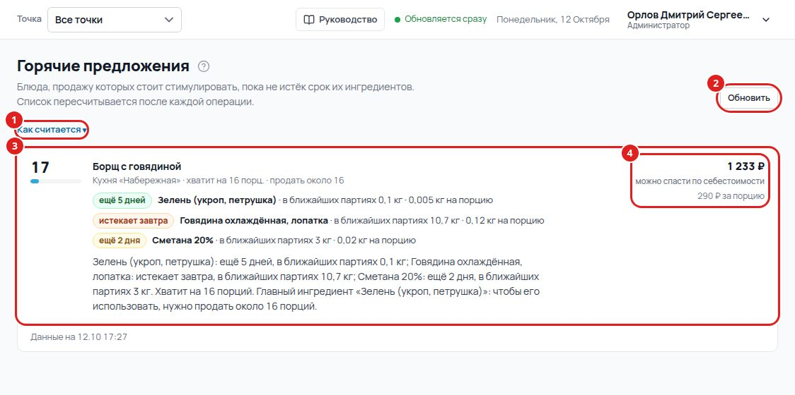

*Раздел «Горячие предложения».* Красные кружки на картинке:

1. Раскрывающееся описание расчёта
2. Пересчёт списка
3. Блюдо с оценкой срочности и числом порций к продаже
4. Сколько продуктов удастся спасти от списания

**Что говорить.** Это ответ на вопрос «что приготовить, чтобы сырьё не пропало». Чем ближе конец срока у ингредиентов, тем выше приоритет блюда. Видите: блюдо, причина, сколько порций продать и сколько денег спасём. Если один ингредиент нужен нескольким блюдам, система делит его между ними по очереди, а не обещает одно и то же дважды. Список обновляется сам: принесли поставку короткого срока, и он перестроился.

**Вопросы и ответы**

**Как считается приоритет?**
Считается в деньгах. Блюдо забирает ингредиент из партий по FEFO. У каждой партии срочность `1 / (1 + суток до срока / 2)` (1 в последний день) и вероятность потери по прогнозу (от 0,3 до 1). Вклад ингредиента: себестоимость забранного × вероятность × срочность. Деньги ингредиентов складываются и приводятся к шкале 0-100: `100 · (1 - e^(-сумма / 300 ₽))`. Блюда ниже 8 в список не попадают. Число порций ограничено обычными продажами блюда за оставшиеся сутки (от 4 до 120), а у нового блюда 24.

**Как вы проверяли, что ранжирование хорошее?**
Прогнали сотни случайных кухонь через свойства (числа конечные, остаток не обещан дважды, порядок входных данных не влияет, невыбранное блюдо ничего не отнимает) и сверили с «оракулом»: сколько денег из реально находящихся под угрозой блюдо способно спасти в одиночку. Корреляция Спирмена выросла с 0,54 у первой версии (она считала долю остатка) до 0,80, а блюдо №1 спасает 82% лучшего возможного вместо 66%. Тесты лежат в `test/domain/hot-dishes-fuzz.test.ts`.

**Что знает система о спросе на блюдо?**
Порции считаются из расхода ингредиентов под именем блюда за 28 суток (последняя неделя весит вдвое). Сколько порций можно продвинуть, ограничено обычными продажами за оставшиеся до срока сутки, поэтому редкое блюдо не получит завышенный приоритет.

**Учитывается ли стоп-лист?**
Да: блюда и продукты из стопа и блюда, которые нельзя приготовить, исключаются.

**Чем отличается от рекомендации «Продвигать»?**
Рекомендация одна из строк общего списка действий, а «Горячие предложения» это отдельный экран с расчётом по блюдам кухни.

---

## 8. Рекомендации и прогноз спроса (1 мин)

**Открыто:** «Рекомендации», блок «Точность прогноза».

**Что показать:** фильтры по типам (списать, скидка, переместить, продвигать, заказать), раскрывающееся «Как считается», карточки точности: ошибка модели против ошибки обычного среднего, на сколько точнее, сколько позиций проверено, сколько с найденной связью с погодой.

**Экран с подсказками**

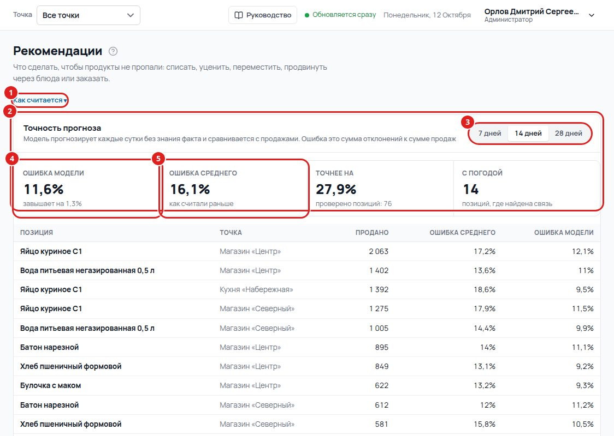

*Раздел «Рекомендации».* Красные кружки на картинке:

1. Как рассчитываются рекомендации
2. Проверка модели спроса на уже случившихся днях
3. Окно проверки: 7, 14 или 28 дней
4. Ошибка прогноза: чем меньше, тем точнее модель
5. С чем сравнивается модель: обычное среднее по продажам

**Что говорить.** Рекомендации это конкретные действия с суммой. Скидка рассчитывается по срочности: 50 процентов за последние сутки, 30 за двое-трое, 15 за неделю, но не ниже себестоимости, кроме последнего дня, когда лучше продать дешевле, чем списать. Перемещение предлагается туда, где продукт расходуется быстрее. Теперь самое интересное: мы не просто говорим, что прогноз хороший, мы его проверяем. Модель прогнозирует каждые сутки без знания факта и сравнивается с продажами. Ошибка модели меньше ошибки обычного среднего, в нашем демо примерно в полтора раза. Эту проверку можно открыть на любой период: 7, 14 или 28 дней.

**Вопросы и ответы**

**Это машинное обучение?**
Нет, и мы это не скрываем: модель состоит из базовой скорости (взвешенное среднее) с поправками на день недели, праздник и погоду. Её плюс в прозрачности: любой расчёт можно объяснить и проверить. Заменить на другую модель можно, не трогая остальную систему.

**Почему вы доверяете этой проверке?**
Модель на каждый проверяемый день использует только данные до этого дня. Ошибка это сумма отклонений относительно суммы продаж. Показатель «Ошибка среднего» это ошибка простого среднего на тех же днях.

**На синтетических данных проверка честная?**
Данные демо сгенерированы с сезонностью, поэтому цифра показывает работоспособность метода, а не доказывает точность на реальной торговле. На реальных данных заказчика её нужно перемерить, и страница для этого уже есть.

**Рекомендации не устаревают?**
Они не хранятся, а считаются по текущим данным. Применение рекомендации это обычная операция с теми же проверками прав.

---

## 9. Живое обновление (1 мин)

**Где индикатор:** в шапке «Обновляется сразу» (метка 3 на [снимке шапки](../apps/web/public/help-img/start.jpg)).

**Что делать:** запустить в терминале эмулятор (см. «Подготовка»). Окно с обзором и окно терминала рядом.

**Что говорить.** Сейчас я запускаю генератор поставок и заказов: он имитирует работу кухни и склада. Смотрите на экран: цифры меняются сами, без перезагрузки страницы, а в терминале видно, какие поставки и заказы приходят и какие заказы система отклоняет из-за нехватки. Это сделано через поток событий: сервер сообщает «данные изменились», а интерфейс перечитывает их обычными запросами с теми же проверками прав.

**Вопросы и ответы**

**Почему SSE, а не WebSocket?**
Нужен односторонний сигнал «данные изменились», SSE проще, проходит через прокси и сам переподключается. В событии нет данных, поэтому утечь через него нечему: клиент перечитывает данные обычными запросами с проверкой прав.

**Как это масштабируется?**
Один экземпляр приложения: кеш расчётов и поток событий живут в памяти процесса. Для нескольких экземпляров нужен общий шлюз событий (например, Redis). Мы это называем среди известных ограничений.

**Эмулятор влияет на реальные данные?**
Он создаёт обычные документы от имени пользователя, поэтому на демо-стенде это безопасно. В боевой работе его не запускают.

---

## 10. Поставщики, потери, уценка (1 мин)

**Открыто:** «Поставщики», затем «Обзор» (блок «Спасено уценкой»).

**Что показать:** оценка A, B, C, выполнение заказов, сроки, свежесть при приёмке, потери в рублях и их причины.

**Экран с подсказками**

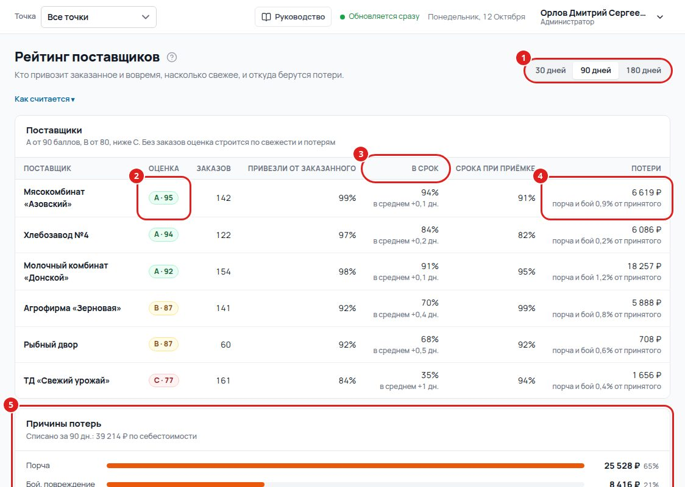

*Рейтинг поставщиков.* Красные кружки на картинке:

1. Период оценки: 30, 90 или 180 дней
2. Оценка поставщика от A до C
3. Доля поставок в срок и среднее опоздание
4. Потери из-за порчи и боя
5. Куда уходят списания по причинам

**Что говорить.** Система оценивает поставщиков по четырём вещам: сколько привезли от заказанного, вовремя ли, насколько свежее товар при приёмке и сколько потерь по их партиям с разбивкой на причины: истёк срок, порча, бой. Оценка от A до C помогает решать, у кого заказывать. А скидка на партию автоматически попадает на кассу: продажа идёт по цене со скидкой, а отчёт «спасено» показывает, сколько денег мы вернули уценкой.

**Вопросы и ответы**

**Как считается оценка?**
Баллы: A от 90, B от 80, ниже C. Входят выполнение заказов, соблюдение сроков, свежесть при приёмке, потери. Если заказов нет, оценка строится по свежести и потерям.

**Как скидка попадает на кассу?**
В ленте `GET /pos/products` у товара появляется поле скидки на ближайшую по FEFO партию, а при создании или отмене скидки в очередь вебхуков ставится событие `promotion.changed`.

**А если партию продали со скидкой не по FEFO?**
Продажа всегда берёт цену со скидкой у той партии, с которой списывает, то есть по FEFO.

---

## 10а. Кабинет поставщика (3 мин)

**Открыто:** «Заказы» у менеджера и вторая вкладка с кабинетом поставщика https://litvinskiy-dev.ru/supplier/. На экране входа в «Запас» есть кнопка «Перейти в «Отгрузку»»: она ведёт в кабинет поставщика, можно показать переход одним нажатием (выйдите из «Запаса», чтобы открыть экран входа).

**Что показать:**
1. У менеджера «Заказы»: заказ молочному комбинату «Донской» в статусе «Отправлен поставщику», в карточке видно «Кабинет поставщика: передан».
2. В кабинете поставщика (`zakaz@donskoy-moloko.example`): сводка, «Заказы → Новые», заказ с составом. «Подтвердить» с датой поставки и сообщением.
3. Обратно к менеджеру: статус стал «Подтверждён поставщиком», видны дата, сообщение и история. Затем у менеджера «Принять поставку» (приход по заказу) или «Замечание по приёмке» / «Отказаться от поставки».
4. В кабинете «Обновить у покупателя»: виден итог приёмки. Раздел «Покупатели»: два покупателя, один из них из другой организации.

**Экран с подсказками**

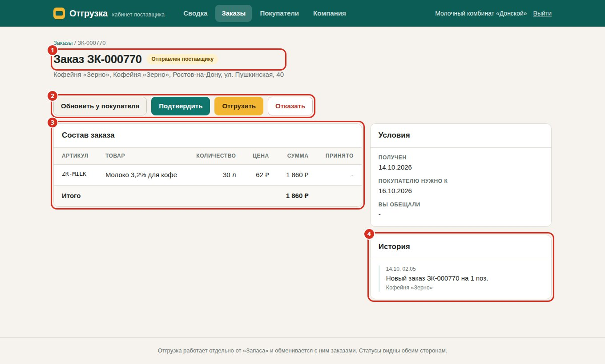

*Кабинет поставщика.* Красные кружки на картинке:

1. Номер заказа и его статус у покупателя
2. Действия поставщика: подтвердить, отгрузить, отказать
3. Состав заказа с ценами и принятым количеством
4. История: ответы поставщика и решения покупателя

**Что говорить.** «Отгрузка» это отдельная система для поставщика: свой адрес, свои пользователи, своя база. Поставщик регистрируется по ИНН, и заказы находят его сами. Когда менеджер отправляет заказ, он уходит и письмом, и в кабинет. Все запросы между системами подписаны общим секретом, чужой запрос получает отказ. Поставщик подтверждает заказ, и мы сразу видим это у себя: статус, дата и его сообщение. Когда товар приехал, менеджер принимает поставку одним нажатием, а если привезли не то, пишет замечание или отказывается от поставки, и поставщик видит решение. Обратите внимание на два покупателя у «Донского»: вторая организация живёт в этой же платформе, но её данные нам не видны, и наши ей тоже.

**Вопросы и ответы**

**Зачем отдельная система, а не раздел внутри «Запаса»?**
Поставщик не сотрудник покупателя: у него свои пользователи, свои покупатели и свои права. Он не должен видеть ничего, кроме адресованных ему заказов. Поэтому система отдельная, а обмен идёт по HTTP с подписью.

**Как связываются система покупателя и поставщик?**
По ИНН. У поставщика в справочнике «Запаса» указан ИНН, при регистрации в кабинете поставщик вводит тот же. Заказ, пришедший раньше регистрации, ждёт поставщика и появляется сразу после неё.

**Что если кабинет недоступен?**
Заказ в «Запасе» считается отправленным, причина видна в карточке, а система повторяет передачу каждую минуту. Статус поставщика, наоборот, принимается кабинетом только после согласия «Запаса»: рассинхронизации нет.

**Как защищён обмен?**
Подпись HMAC-SHA256 от времени и содержимого, разброс времени не больше пяти минут, общий секрет в окружении серверов. Тесты проверяют чужую подпись, старое время и отсутствие подписи.

**Это настоящий кабинет или заглушка?**
Рабочий: регистрация, вход с блокировкой после неудач, заказы, действия, история, покупатели, профиль, 13 автотестов. Не делали каталог и прайс поставщика, электронные накладные и онлайн-оплату.

---

## 11. НАССП и прослеживаемость (1 мин)

**Открыто:** «Журнал НАССП», затем «Прослеживаемость».

**Что показать:** контрольные точки (холодильники, морозильники, горячая линия) с нормой температуры и частотой замеров, просроченный замер, отклонение без действия. Дальше реестр ВСД: просроченные и ожидающие погашения, вкладка «Марки».

**Экран с подсказками**

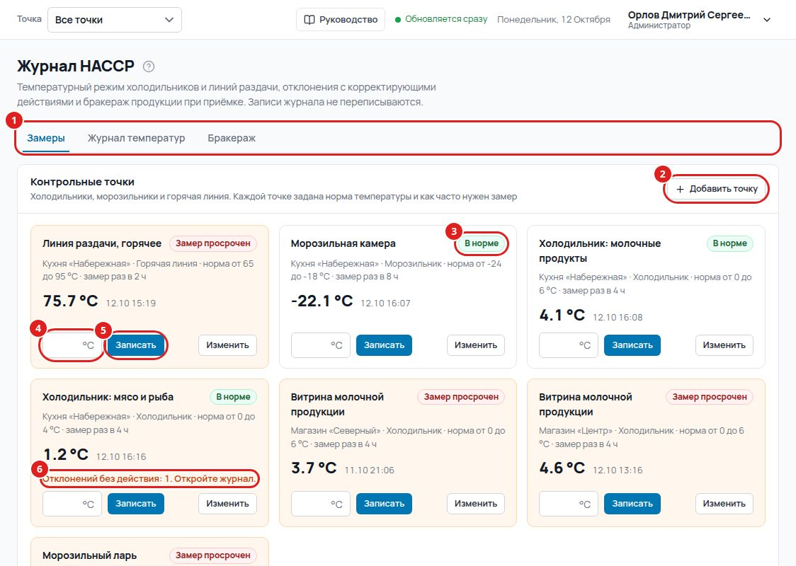

*Журнал НАССР, замеры.* Красные кружки на картинке:

1. Замеры, журнал температур, бракераж
2. Новая контрольная точка с нормой температуры
3. Состояние точки: в норме, вне нормы или замер просрочен
4. Поле для записи температуры
5. Запись замера в журнал
6. Отклонение, по которому не записаны меры

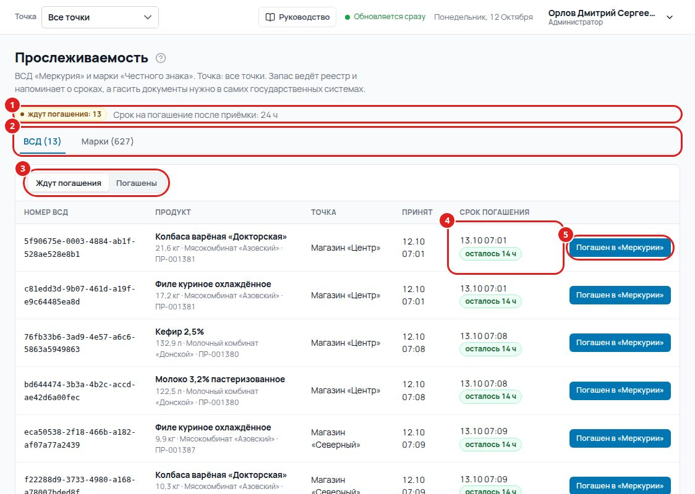

*Раздел «Прослеживаемость».* Красные кружки на картинке:

1. Сколько документов ждёт погашения и сколько просрочено, и срок после приёмки
2. Вкладки: ВСД и марки
3. Фильтр: ждут погашения или уже погашены
4. Срок погашения и сколько осталось
5. Отметка о погашении в «Меркурии»

**Что говорить.** Для общепита важно не только считать, но и доказывать. В журнале НАССП у каждой точки норма температуры и частота замеров. Отклонение без корректирующего действия подсвечено, замер хранит границы, действовавшие на момент записи, поэтому смена норм не переписывает историю. Теперь прослеживаемость: номер ВСД «Меркурия» и коды марок записываются при приходе, система напоминает о сроке погашения и подсвечивает просроченное. Честно скажем: погашение выполняется в самих государственных системах, мы ведём реестр и напоминаем.

**Вопросы и ответы**

**Вы интегрированы с «Меркурием» и «Честным знаком»?**
Нет, и мы не заявляем этого. Мы ведём реестр и сроки, гасит документы человек в государственных системах. Прямой обмен вынесен в развитие.

**Можно ли править журнал задним числом?**
Нет: таблицы замеров, действий и осмотров входят в набор «только дополнять» (триггеры и права базы), правка идёт новой записью.

**Есть выгрузка для проверяющих?**
Да, выгрузка журнала в CSV, защищённая от формульных инъекций.

---

## 12. Кассы и 1С (3 мин)

**Открыто (локальный стенд):** «Администрирование → Кассы» и «Учётные системы». В терминалах запущена имитация 1С и подготовлены подключения.

**Что показать, по порядку:**
1. «Кассы»: «Подключить кассу», выбор вендора (Эвотор, Фронтол, АТОЛ, iiko, Sigma или своя), адрес и ключ, образец чека и кнопка «Проверить».
2. Запустить `npm run emulate:pos -- --key zk_... --vendor evotor`: чеки списывают остатки.
3. «Неопознанные позиции»: чек с неизвестной позицией ждёт, «Сопоставить» доигрывает его.
4. «Учётные системы»: «Проверить» (зелёные галочки по справочникам и документам), затем приход в «Операциях» уходит в 1С, «Отправить в 1С» ещё раз обновляет тот же документ.
5. Остановить имитацию 1С: задание уходит в повторы, после запуска догружается.

**Экран с подсказками**

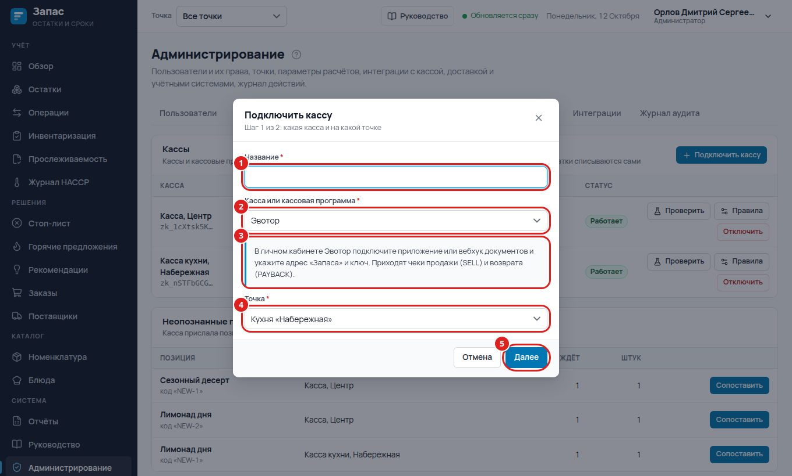

*Подключение кассы, шаг 1.* Красные кружки на картинке:

1. Название кассы
2. Тип кассы или кассовой программы
3. Подсказка по выбранной кассе: что настроить на её стороне
4. Точка, на которой стоит касса
5. Создать подключение и получить ключ

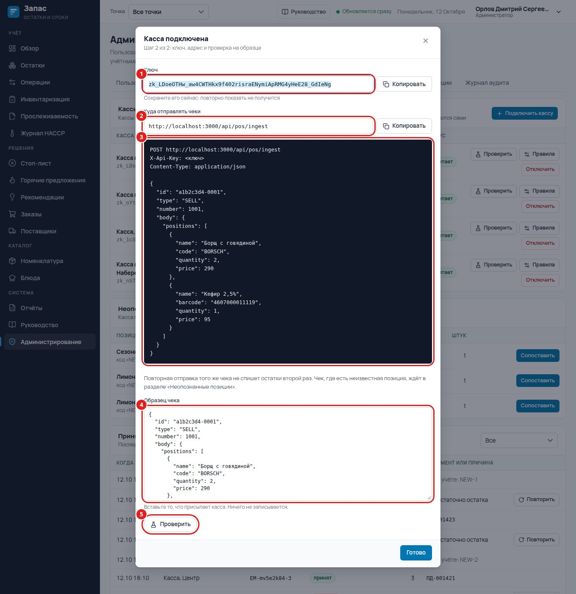

*Подключение кассы, шаг 2.* Красные кружки на картинке:

1. Ключ кассы: показывается один раз
2. Адрес, на который касса отправляет чеки
3. Как выглядит запрос кассы в формате выбранного вендора
4. Образец чека: его можно заменить своим
5. Показать, как чек разобран и что найдено в номенклатуре

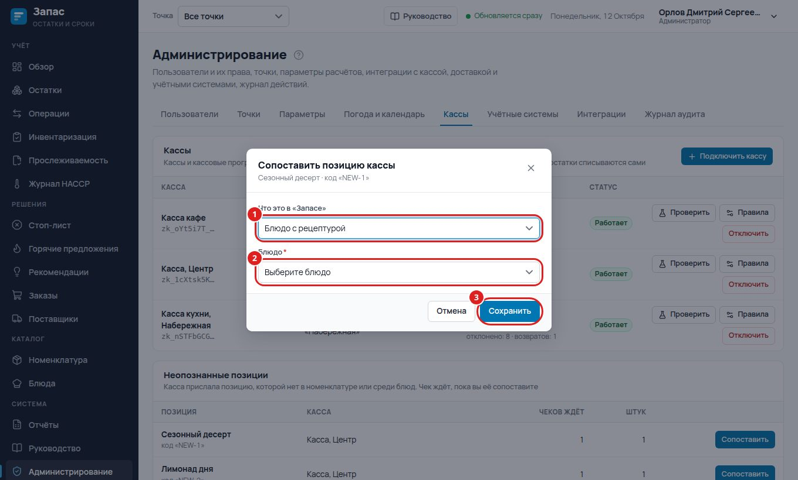

*Сопоставление неопознанной позиции.* Красные кружки на картинке:

1. Чем является позиция: продукт, блюдо или «не считать»
2. Блюдо или продукт, которому соответствует код кассы
3. Запомнить связь: ждавшие чеки обработаются сразу

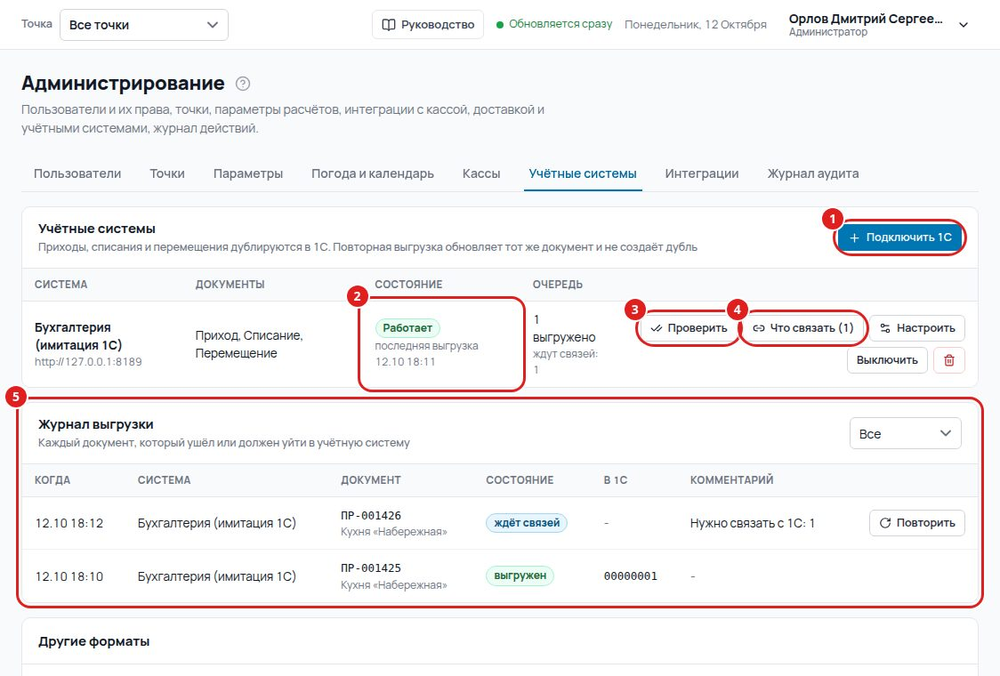

*Администрирование, учётные системы.* Красные кружки на картинке:

1. Подключение 1С: адрес, пользователь, документы
2. Состояние обмена и время последней выгрузки
3. Проверка: отвечает ли 1С и есть ли нужные объекты
4. Соответствие продуктов, поставщиков и складов объектам 1С
5. Каждый документ, ушедший в 1С или ждущий отправки

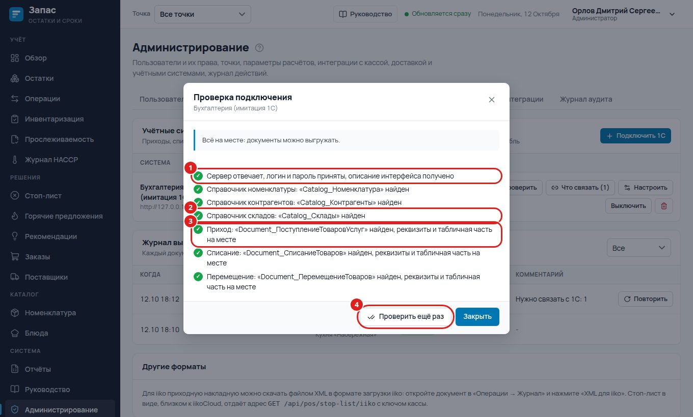

*Проверка подключения к 1С.* Красные кружки на картинке:

1. Связь, логин и пароль
2. Справочники 1С, по которым ищутся соответствия
3. Документ, реквизиты и табличная часть найдены в интерфейсе 1С
4. Повторить проверку после правки настроек

**Что говорить.** Флагман работает с кассами Эвотор, Фронтол, АТОЛ, iiko, Sigma и с 1С, поэтому «Запас» подключается к ним настройкой, а не программированием. Берём кассу: выбираем вендора, получаем адрес и ключ, видим образец чека и нажимаем «Проверить». Правила разбора настраиваются: JSON, XML или CSV, поэтому подключить можно любую кассу, умеющую отправить чек. Запускаю эмулятор кассы: чеки пошли, остатки списываются. Если в чеке позиция, которой нет в номенклатуре, она не теряется, а попадает в «Неопознанные»: сопоставляем один раз, и чек доигрывается.
Теперь 1С. Профили: Бухгалтерия 3.0, Розница 3, УТ 11, УНФ или своя настройка. «Проверить» читает описание интерфейса 1С и показывает, каких объектов не хватает. Проводим приход, и документ ушёл в 1С. Нажимаю «Отправить» повторно: он обновился, а не задублировался. Теперь остановлю 1С: документ встаёт в очередь с нарастающей паузой повтора, запускаем 1С обратно, и он догружается сам. Честно скажем: это проверено на эмуляторах и по открытым описаниям форматов, сертификации производителей нет.

**Вопросы и ответы**

**Как подключить кассу, которой нет в списке?**
Через «Другая касса»: указываете, где в чеке лежат номер, строки, код, количество, цену (пути для JSON и XML, колонки для CSV), проверяете на образце. Дальше работает как остальные.

**Что с возвратами?**
Возвраты фиксируются как отдельные записи в журнале и отчёте, склад без явного правила не меняют: это решение владельца процесса, а не системы.

**Как защищён приём чеков?**
Ключ кассы привязан к одной точке и может только присылать чеки, показывается один раз, хранится в виде хэша. Чек идемпотентен по номеру: повтор не списывает остатки второй раз.

**Как 1С понимает документы, если конфигурации разные?**
Имена документов и табличных частей зависят от конфигурации, поэтому профили настраиваются, а «Проверить» сверяет их с описанием интерфейса сервера (`$metadata`). Обмен идёт по стандартному интерфейсу OData.

**Что если 1С недоступна?**
Задание в очереди повторяется: через 30 секунд, 2 минуты, 10 минут, час, 6 часов. Если не хватает связей справочников, оно ждёт в статусе «Что связать» и уйдёт после сопоставления.

**Как не получить дублей в 1С?**
Связь документа с объектом в 1С хранится (`external_refs`), повторная выгрузка обновляет документ по этому ключу.

**А iiko?**
Для iiko есть выгрузка прихода в XML и стоп-лист в виде, близком к iikoCloud. Как и 1С, проверено на эмуляторах и по описаниям форматов.

**Безопасно ли разрешать серверу ходить по адресам?**
Адреса обмена проверяются защитой от SSRF; частные адреса разрешаются только явным списком `EXCHANGE_ALLOW_HOSTS`, по умолчанию он пуст.

---

## 13. Telegram-бот (1 мин)

**Открыто:** Telegram, чат с @zapashack_bot.

**Что показать:** `/today`, `/risks` и кнопка «Скидка» с подтверждением, `/stock молоко`, `/hot`, `/subscribe`.

**Экран с подсказками**

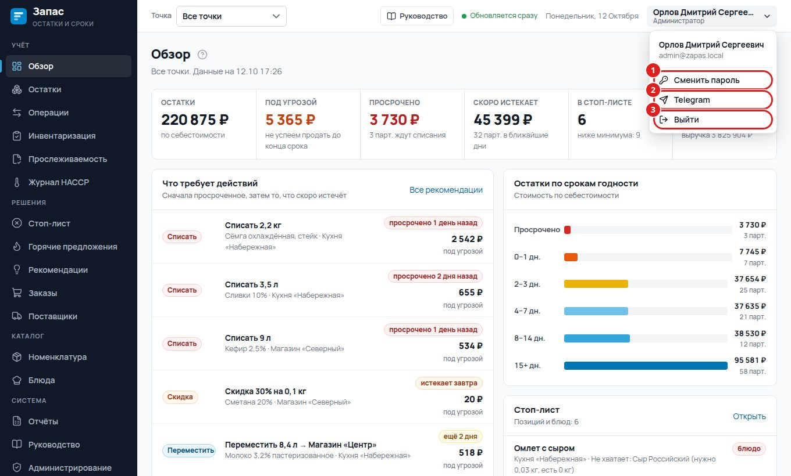

*Меню пользователя.* Красные кружки на картинке:

1. Смена пароля: после неё остальные сессии закрываются
2. Привязка Telegram для личных уведомлений и бота
3. Выход из системы на этом устройстве

**Что говорить.** Бот отвечает с правами сотрудника, чей аккаунт привязан. Привязка одноразовым кодом из меню пользователя, код живёт 10 минут. `/today`: сводка за сегодня. `/risks`: что списать, уценить, переместить, а под рекомендациями кнопки. Нажимаю «Скидка»: бот просит подтвердить и применяет скидку теми же сервисами, что и сайт, с записью в журнал аудита. Кладовщик увидит только свои точки. Подписки на утреннюю сводку и стоп-лист у каждого свои.

**Вопросы и ответы**

**Не может ли чужой человек управлять складом через бота?**
Нет: без привязки бот не отвечает данными, привязка требует вход в систему и одноразовый код. Привязка снимается при смене пароля и при отключении пользователя. Кнопки действий разбираются строго по белому списку и требуют подтверждения.

**Почему бот работает через прокси?**
С нашего сервера Telegram напрямую недоступен, поэтому запросы идут через SOCKS5-прокси. Данные прокси лежат только в окружении сервера.

**А если запустить несколько экземпляров?**
Один токен опрашивает один экземпляр, на остальных задаётся `TELEGRAM_COMMANDS=false`.

---

## 14. Интерфейс, сканер, руководство (1 мин)

**Открыто:** меню пользователя (тема и вид), Ctrl+K, «Руководство», страница «Тестирование».

**Что показать:** три темы (светлая, тёмная, разноцветная), «Обычный» и «Расширенный» вид, палитра команд, телефонный вид, «Руководство» с красными кружками на скриншотах, «Тестирование → Штрихкоды» и «Проверка системы».

**Экран с подсказками**

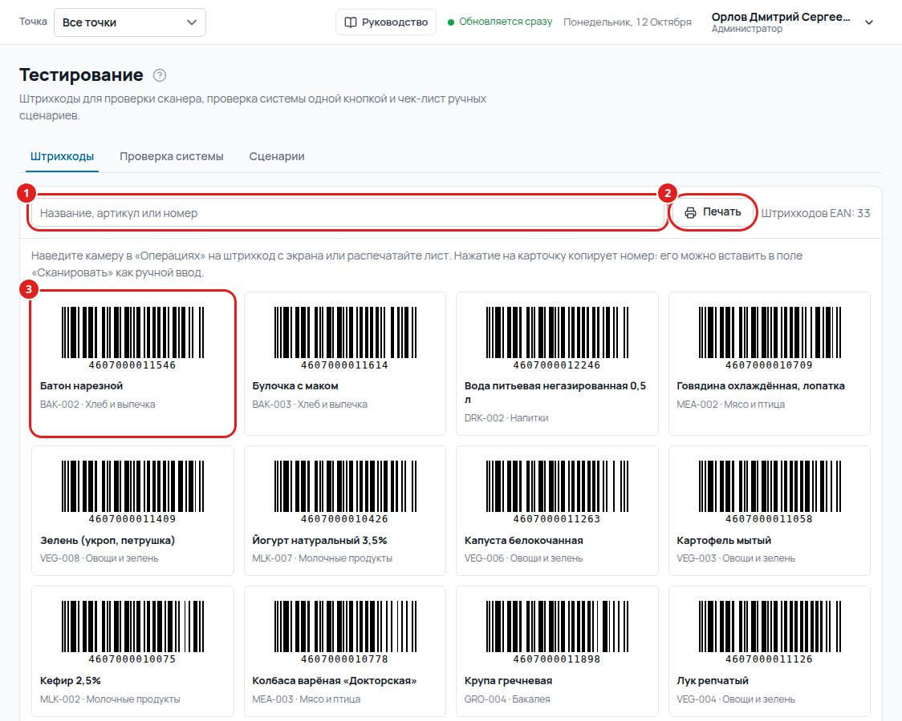

*Тестирование, штрихкоды.* Красные кружки на картинке:

1. Поиск по названию, артикулу или номеру
2. Печать листа со штрихкодами для проверки камерой
3. Штрихкод EAN: нажатие копирует номер для ручного ввода

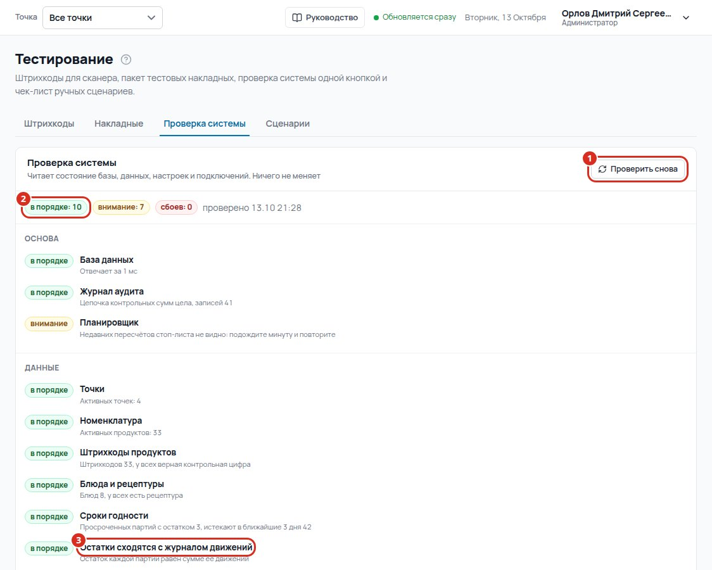

*Тестирование, проверка системы.* Красные кружки на картинке:

1. Повторить проверку
2. Итог: сколько пунктов в порядке, требуют внимания или упали
3. Главный инвариант учёта: остаток партии равен сумме движений

**Что говорить.** Интерфейс работает на компьютере и на телефоне, есть три темы и два вида: обычный и расширенный с анимациями. По Ctrl+K открывается быстрый переход. Рядом с заголовком каждой страницы кнопка со знаком вопроса, а в «Руководстве» каждый раздел расписан по шагам со скриншотами и красными кружками. В «Тестировании» штрихкоды всех продуктов для проверки сканера и кнопка «Проверка системы», которая читает базу, журнал аудита, сходимость остатков и настройки.

**Вопросы и ответы**

**Доступность?**
Настоящие подписи полей, видимый фокус, контраст не ниже AA (проверен скриптом по всем экранам), уважение к `prefers-reduced-motion`.

**Работает ли на телефоне?**
Да: боковое меню прячется за кнопкой, таблицы превращаются в карточки, формы идут в одну колонку.

**Что делает «Проверка системы»?**
Проверяет доступность базы, цепочку журнала аудита, сходимость остатков с журналом движений, настройки и подключения. Нужна как быстрая самодиагностика перед работой.

---

## 15. Безопасность, надёжность, стек (1 мин)

**Что говорить.** Коротко о надёжности. Пароли хранятся Argon2id, токен доступа живёт 15 минут, refresh-токен ротируется, а повторное предъявление использованного токена отзывает всю цепочку. Роли проверяются на сервере для каждого маршрута, а кладовщик видит только свои точки. Журнал движений неизменяем, журнал аудита связан цепочкой контрольных сумм: подмену записей находит проверка. Заголовки безопасности и строгий CSP включены. На 54 тысячах партий продажа занимает около 10 миллисекунд, стоп-лист 20, панель 150-200, а пачка из 300 одновременных запросов обрабатывается за 3-4 секунды без отказов. Стек: TypeScript на сервере и клиенте, Node 22 и Fastify, React, PostgreSQL, всё в Docker за nginx. Тесты идут на реальной базе, включая гонки и права.

**Вопросы и ответы**

**Что вы НЕ сделали или что не доведено?**
Честный список: нет двухфакторной аутентификации (для администраторов советуем ограничить доступ сетью), ограничение частоты запросов хранится в памяти процесса (при нескольких экземплярах нужен общий склад), один экземпляр приложения, модель спроса не машинная, ВСД и марки ведутся как реестр без прямого обмена, кассы и 1С проверены на эмуляторах без сертификации, наблюдатель и кладовщик видят себестоимость по своим точкам.

**Как будете масштабировать?**
Вертикально до десятков тысяч партий уже сейчас (замеры выше). Для нескольких экземпляров нужны общий склад для лимитов и событий, а чтения можно разнести по репликам базы.

**Как защищены секреты?**
Только из окружения, при старте проверяются на длину и отсутствие значений по умолчанию, в production сервер не стартует с неподходящей конфигурацией. Токен бота и прокси лежат только в `.env` на сервере и не попадают в репозиторий.

**Как проверять качество?**
Тесты на реальной PostgreSQL: вход и токены, матрица ролей и точек, операции со складом, идемпотентность, гонка продаж, инвентаризация, стоп-лист, аналитика, заголовки безопасности, неизменяемость журналов, обмен с 1С и приём чеков. Плюс самопроверка системы в интерфейсе.

**Почему TypeScript и Kysely, а не ORM?**
Типы общие для сервера и клиента (схемы Zod в общем пакете), запросы параметризованы и читаются как SQL, а блокировки партий нам нужно задавать явно.

**Как задеплоено?**
Docker Compose (база и приложение) за nginx с сертификатом Let's Encrypt, миграции применяются при старте контейнера, контейнер не от root и с файловой системой только для чтения.

---

## 16. Итоги (1 мин)

**Что говорить.** Подведём итог. Мы выполнили все 17 условий кейса: приём поставок и партии, контроль сроков и FEFO, автоматический стоп-лист и его прогноз, горячие предложения, автосписание, аналитика списаний и дефицит, обновление в реальном времени, генератор и дашборд. Сверх кейса: оценка поставщиков, уценка в кассу, проверяемый прогноз, журнал НАССП, прослеживаемость, подключение касс и 1С, Telegram-бот, сканер, руководство. Стенд открыт: litvinskiy-dev.ru, бот @zapashack_bot, код в репозитории. Будем рады вопросам и обратной связи.

**Общие вопросы в конце**

**Что бы вы сделали дальше?**
Прямой обмен с «Меркурием» и ГИС МТ, сертифицированные коннекторы iiko и 1С, электронный обмен заказами с поставщиками, мобильное приложение для инвентаризации, более сильная модель спроса.

**Что самое сложное было сделать?**
Корректные остатки при конкурентных операциях (блокировки партий, идемпотентность) и расчёт «под угрозой» по партиям с честной оговоркой про недостаток истории.

**Какую ценность это даёт бизнесу?**
Меньше просрочки и потерь, раньше замеченный дефицит, предсказуемый стоп-лист, меньше ручного учёта и меньше отказов гостям.

**Что если эксперт просит показать вживую то, чего нет в сценарии?**
Открыть «Руководство», там по каждому разделу описание и снимки. Если функции действительно нет, так и сказать: «этого нет, вот как мы это добавили бы», без попыток выкрутиться.

---

## Шпаргалка по цифрам

| Что | Значение |
|---|---|
| Условий кейса выполнено | 17 из 17 |
| Демо-данные | 4 точки, 33 продукта, 8 блюд, 60 дней продаж |
| Роли | администратор, менеджер, кладовщик, наблюдатель |
| Пороги сроков по умолчанию | критично 1 день, скоро истекает 3 дня |
| Окно скорости продаж | 28 суток, последняя неделя весит вдвое |
| Скидки по срочности | 50% (0-1 сутки), 30% (2-3), 15% (4-7) |
| Повторы обмена с 1С | 30 с, 2 мин, 10 мин, 1 ч, 6 ч |
| Время жизни токена доступа | 15 минут |
| Нагрузка на 54 тыс. партий | продажа 10 мс, стоп-лист 20 мс, панель 150-200 мс |
| Гонка продаж | 20 параллельных продаж на остаток 10 продают ровно 10 |
| Адреса | https://litvinskiy-dev.ru, @zapashack_bot |
